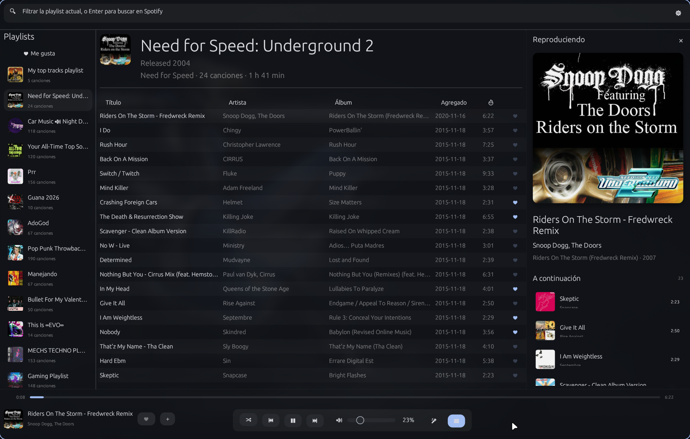
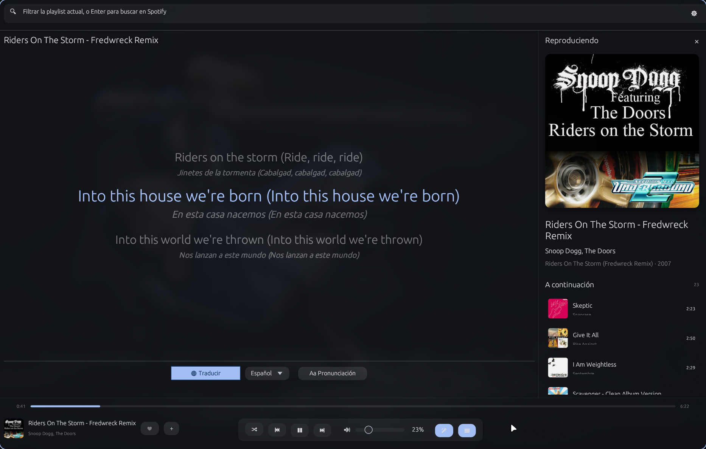

# psst-egui

A lightweight, native Spotify client for Linux, written in Rust with [egui](https://github.com/emilk/egui). No Electron, no browser engine: about **150 MB of RAM and ~1.4 % of a CPU core** while playing, and no repaints at all while paused or idle.

It is a fork of [jpochyla/psst](https://github.com/jpochyla/psst). The audio engine (`psst-core`) is upstream's; the GUI, library access and everything around it were rebuilt from scratch. The original Druid GUI is still in the workspace as `psst-gui` (see [README.psst.md](README.psst.md)).

<p align="center">
  
</p>
<p align="center">
  
  
</p>

> A **Spotify Premium** account is required (playback goes through Spotify's streaming protocol).

## Features

- **Library**: your playlists and Liked Songs, with sortable columns, a local filter, all artists per track and the real name of each playlist's owner.
- **Global search**: press Enter in the search box to search Spotify. Results are split into chips (All, Songs, Artists, Albums, Playlists) with a best-result card and "See all" paging. Artist and album pages open in place, artist names are links everywhere, and Back (`Alt+←`) returns to where you were.
- **Likes and playlists**: heart any track, add it to one of your own playlists (`+` in the player bar or right-click).
- **Now Playing panel**: large cover, track info and the upcoming queue; click a queued track to jump to it.
- **Lyrics**: karaoke-style, synced view (🎤 in the player bar) with translation to 10 languages (via DeepL) and **pronunciation** in Latin letters — romaji for Japanese, pinyin for Chinese.
- **Desktop integration**: MPRIS with all artists and the album (media keys, `playerctl`, shell widgets), app volume kept in sync with PipeWire/PulseAudio (change it from pavucontrol or your shell and the slider follows), and a fixed window class (`psst-egui`) for window rules.
- **Remembers your session**: last playlist/track/position (resumes paused), volume, window size and position, UI scale and panel state.
- **Fast start**: the window opens instantly and connects in the background. The playlist sidebar is cached on disk and shows up right away, then refreshes in the background, fetching only the playlists that changed. First-run login and settings live inside the app.
- **Housekeeping**: the audio cache is capped at 2 GB (oldest tracks are dropped at startup); playlist covers are cached and pruned automatically.
- **Theming**: three color sources, picked in Settings and reloaded live when the files change:
  - *Por defecto*: the [noctalia](https://github.com/noctalia-dev) palette from kitty's generated theme (`~/.config/kitty/themes/noctalia.conf`), or a neutral dark palette without it.
  - *DMS*: the wallpaper colors from `~/.cache/dms/dms-colors.json`.
  - *GTK3*: `@define-color` entries in `~/.config/gtk-3.0/gtk.css` (falls back to `gtk-4.0/gtk.css`).

  The window is transparent, so compositor blur works.

### Keyboard shortcuts

| Key | Action |
| --- | --- |
| `Space` | Play / pause |
| `←` / `→` | Seek 5 s back / forward |
| `↑` / `↓` | Volume up / down |
| `N` / `P` | Next / previous track |
| `Ctrl+F` / `Esc` | Focus / leave the search box |
| `Ctrl+1` … `Ctrl+5` | Switch search chip |
| `Alt+←` | Back (from an artist, album or playlist page) |
| `Ctrl+R` | Toggle the Now Playing panel |
| `Ctrl++` / `Ctrl+-` / `Ctrl+0` | UI scale up / down / reset |

## Install

### Arch Linux

There is no AUR package; build it from the checkout:

```sh
git clone https://github.com/Jesuarzm/psst-egui.git
cd psst-egui/packaging/arch
makepkg -si
```

The first build downloads a Japanese dictionary (see [Building](#building)), so it needs network access.

### Other distributions

```sh
cargo build --release --locked -p psst-egui
./target/release/psst-egui
```

You need a recent stable Rust toolchain, `pkg-config`, and development headers for ALSA and OpenSSL (e.g. `libasound2-dev libssl-dev` on Debian/Ubuntu). At runtime: Wayland/X11 libraries, OpenGL (Mesa), `xdg-utils` (opens the browser for login) and `pactl` (`libpulse`) for the volume sync. `noto-fonts-cjk` is recommended for CJK lyrics.

## First run

1. Launch `psst-egui` and press **Iniciar sesión con Spotify**. Your browser opens to authorize the app; a second authorization follows for the library session. Copy-paste links are shown if the browser doesn't open.
2. Optional, in **Ajustes (⚙)**:
   - **Interfaz**: UI scale and the color source (see *Theming*).
   - **DeepL**: paste a free [API key](https://www.deepl.com/pro-api) to enable lyric translation.
   - **Search**: create an app on the [Spotify Developer Dashboard](https://developer.spotify.com/dashboard), add the Redirect URI shown in the settings window (`http://127.0.0.1:8888/login`), paste its Client ID and press *Conectar*. Without it, the search box only filters the current playlist. Apps in *development mode* get a reduced Web API (smaller pages, no artist top tracks); the client works around it.

Credentials and keys are stored **in plain text** in `~/.config/Psst/config.json` (shared with `psst-gui`); other state (settings, resume point, track and playlist caches, audio cache) lives in `~/.cache/psst-tui/`, and the library session in `~/.cache/spotify-client/`.

> The UI is currently in Spanish.

## How it compares

Same track, same machine (CachyOS, Hyprland), 60 s playing / 30 s paused, PSS memory, one pass per client — indicative, not a rigorous benchmark. Measured before the idle work: psst-egui no longer repaints while paused, so its paused CPU is now close to zero.

| Client | RAM (playing) | CPU (playing) | CPU (paused) | Window ready |
| --- | --- | --- | --- | --- |
| Spotify (official) | 996 MB | 19.95 % | 21.6 % | 0.2 s |
| psst-gui (upstream) | 172 MB | 3.30 % | 1.33 % | 0.1 s |
| **psst-egui** | **154 MB** | **1.43 %** | **0.83 %** | **0.08 s** |
| spotify-player (TUI) | 58 MB | 2.62 % | 2.23 % | — |
| ncspot (TUI) | 45 MB | 1.47 % | 0.30 % | — |
| spotifyd (headless) | 21 MB | 0.87 % | 0.57 % | — |

## Building

The workspace is upstream's plus two crates:

- `psst-egui` — the GUI (egui/eframe).
- `psst-backend` — the library the GUI uses (session, library, lyrics, translation, search, MPRIS, settings…). It was called `psst-tui` in early development; the on-disk state directory (`~/.cache/psst-tui/`) and the MPRIS bus name (`psst-tui`) keep that legacy name.

Notes:

- `librespot-core` and `vergen-gitcl` are **vendored** in `psst-backend/vendor` and wired in through `[patch.crates-io]`: a dependency conflict in `vergen-gitcl 1.0.x` currently breaks a fresh build of `librespot-core` from crates.io.
- Japanese romanization uses `lindera` with an embedded IPADIC dictionary, which its build script **downloads at compile time** (and adds ~47 MB to the binary).
- Distro-wide aggressive `CFLAGS` (e.g. CachyOS `-march=native`) can break the assembler step of `ring`; the PKGBUILD unsets them for the build.
- Korean pronunciation is intentionally not implemented (the only available crate is GPL-3.0).

## Troubleshooting

- `PSST_DEBUG_REPAINT=1 psst-egui` prints to stderr why each frame was drawn — useful if the app uses CPU while idle.
- Every thread is named, so `pidstat -t -p $(pgrep -x psst-egui)` shows which part is busy.
- Playlist loading reports failures on stderr (`playlists: …`).

## Known limitations

- Developed and tested on CachyOS + Hyprland (Wayland). Other setups probably work but are untested. Tiling window managers may ignore the minimum window size; the layout narrows the sidebar and hides the Now Playing panel when space runs out.
- With a Spotify app in *development mode*, the Web API rejects several endpoints; likes and playlist edits use the newer `/me/library` and `/playlists/{id}/items` routes, and adding tracks works on your own playlists only.
- Playlists made by Spotify's DJ feature have no tracks over the streaming protocol and are hidden.

## License

MIT, like upstream — see [LICENSE.md](LICENSE.md). Built on [psst](https://github.com/jpochyla/psst) by Jan Pochyla and contributors, and on [librespot](https://github.com/librespot-org/librespot) for library access. Not affiliated with Spotify.
